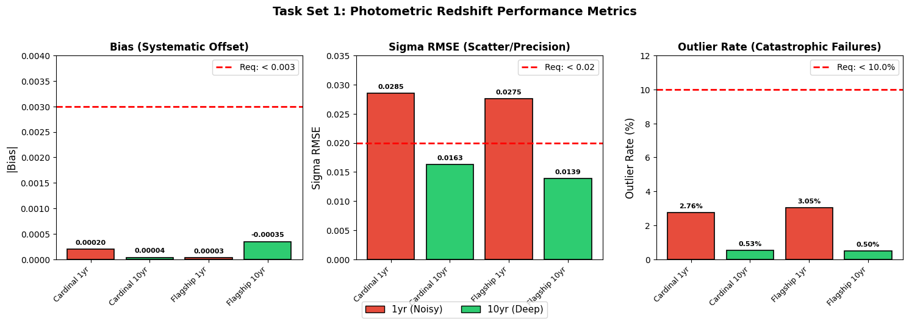
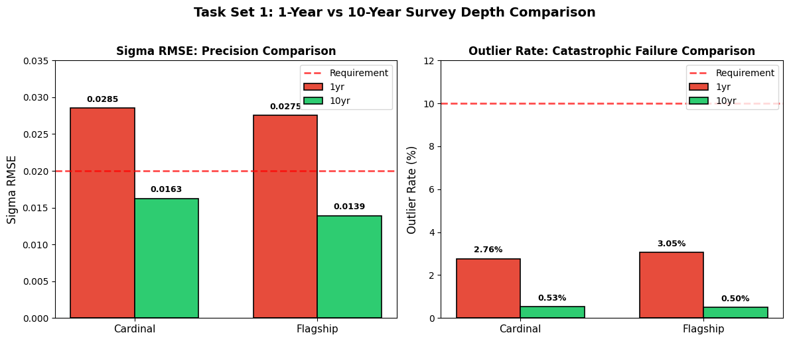
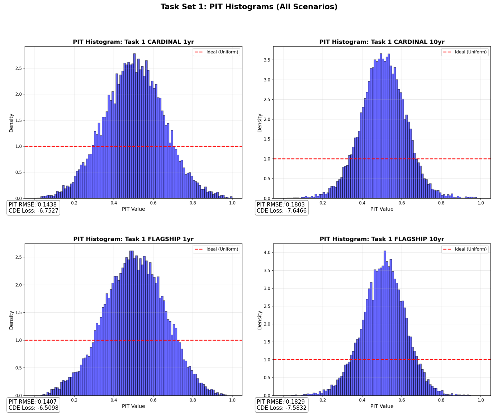

# PZ Challenge Task Set 1: Photometric Redshifts with LSST + Roman

A photometric redshift (photo-z) pipeline for **Task Set 1** of the LSST DESC Photometric Redshift Data Challenge. A LightGBM regressor predicts galaxy redshifts from combined **Rubin/LSST optical** (*ugrizy*) and **Roman near-infrared** (*YJH*) photometry, and an adaptive Gaussian-mixture model turns each prediction into a full redshift probability distribution, p(z).

The pipeline is run on both simulations (**Cardinal** and **Flagship**) at both survey depths (**1-year** and **10-year**).

## Key Results

| Simulation | Depth | Bias | σ<sub>MAD</sub> | σ<sub>RMSE</sub> | Outlier rate | PIT RMSE | CDE loss |
|---|---|---:|---:|---:|---:|---:|---:|
| Cardinal | 1yr | 0.00020 | 0.0165 | 0.0285 | **2.76%** | 0.144 | −6.75 |
| Cardinal | 10yr | 0.00004 | 0.0105 | 0.0163 | **0.53%** | 0.180 | −7.65 |
| Flagship | 1yr | 0.00003 | 0.0175 | 0.0275 | **3.05%** | 0.141 | −6.51 |
| Flagship | 10yr | −0.00034 | 0.0101 | 0.0139 | **0.52%** | 0.183 | −7.58 |

All metrics are measured on a held-out validation set of 15,000 galaxies per scenario (15% of the 100,000-galaxy training catalogue). The challenge test catalogues are unlabelled, so they are only used to produce the p(z) output files. Machine-readable values: [`results/taskset1_validation_metrics.csv`](results/taskset1_validation_metrics.csv).

**Against the LSST point-estimate requirements** (|bias| < 0.003, σ<sub>RMSE</sub> < 0.02, outlier rate < 10%):

| Scenario | Bias | σ<sub>RMSE</sub> | Outlier rate |
|---|:---:|:---:|:---:|
| Cardinal 1yr | ✅ | ❌ 0.0285 | ✅ |
| Cardinal 10yr | ✅ | ✅ | ✅ |
| Flagship 1yr | ✅ | ❌ 0.0275 | ✅ |
| Flagship 10yr | ✅ | ✅ | ✅ |

- **Both 10-year scenarios meet all three requirements.**
- |Bias| is at least ~9× below the requirement in every scenario.
- Outlier rates are ~0.5% at 10-year depth and ≤ 3.05% at 1-year depth, well inside the 10% limit.
- At 1-year depth the scatter (σ<sub>RMSE</sub> ≈ 0.028) misses the 0.02 target. This is driven by the shallower, noisier photometry: going to 10-year depth cuts σ<sub>RMSE</sub> by 43–50% and the outlier rate by 5–6×.





## Approach

### 1. Features: breaking optical colour degeneracies with Roman

Optical-only photo-z suffers from colour degeneracies: galaxies at very different redshifts can have similar *ugrizy* colours. Roman's near-infrared bands extend the wavelength baseline and help separate these cases.

Each galaxy gets **54 features**:

| Feature group | Count |
|---|---:|
| LSST magnitudes + signal-to-noise (*u, g, r, i, z, y*) | 12 |
| Roman magnitudes + signal-to-noise (*Y, J, H*) | 6 |
| All pairwise LSST colours | 15 |
| All pairwise Roman colours | 3 |
| **LSST − Roman cross-survey colours** | **18** |

Signal-to-noise is computed from the magnitude error as SNR = 1.0857 / σ<sub>mag</sub>. Missing values are left as NaN and handled natively by LightGBM rather than filled with a sentinel value.

The feature importances confirm that the near-infrared information matters: the Roman colours *Y−J* and *J−H* are the two most important features in three of the four scenarios, and cross-survey colours such as *z*<sub>LSST</sub>−*Y*<sub>Roman</sub> and *i*<sub>LSST</sub>−*Y*<sub>Roman</sub> also appear in the top five.

### 2. Point estimates: LightGBM

- One model per (simulation, depth) pair, four models in total.
- Target: log(1 + z), which compresses the high-redshift tail; predictions are mapped back with exp(x) − 1.
- Hyperparameters: up to 8,000 trees, learning rate 0.005, 256 leaves, max depth 12, 80% row and column subsampling.
- Early stopping (patience 400 rounds) on a **custom σ<sub>MAD</sub> metric**, so training stops on the quantity being optimised rather than on squared error. The best iterations were 1,760–4,907 trees.

### 3. Redshift distributions p(z): adaptive Gaussian mixture

Each galaxy's p(z) is a 3-component Gaussian mixture:

| Component | Mean | Width | Role |
|---|---|---|---|
| 1 | LightGBM prediction | 0.03 + 0.04 × faintness | Sharp peak around the point estimate |
| 2 | Median redshift of the 200 nearest training neighbours (in feature space) | Neighbour spread + 0.02 + 0.03 × faintness | What similar-looking galaxies actually are |
| 3 | LightGBM prediction | 2.5 × component 2 width | Broad fallback for catastrophic cases |

`faintness = max(0, i − 21.5)`, where *i* is the LSST *i*-band magnitude. Fainter galaxies get wider components and shift weight from the point estimate (component 1) to the neighbour distribution (component 2). The mixtures are stored as [`qp`](https://github.com/LSSTDESC/qp) ensembles with `zmode` and `object_id` ancillary data.

### 4. Metrics

With Δz = (z<sub>pred</sub> − z<sub>true</sub>) / (1 + z<sub>true</sub>):

- **Bias:** median(Δz)
- **σ<sub>MAD</sub>:** scaled median absolute deviation of Δz (robust scatter)
- **σ<sub>RMSE</sub>:** root-mean-square of Δz over the full validation set, outliers included
- **Outlier rate:** fraction of galaxies with |Δz| > 0.06
- **PIT:** CDF of each p(z) evaluated at the true redshift (400-point grid, 0 ≤ z ≤ 4). **PIT RMSE** is the distance of the sorted PIT values from a uniform distribution (0 = perfectly calibrated).
- **CDE loss:** ∫p(z)² dz − 2 p(z<sub>true</sub>), averaged over galaxies (lower is better)

## p(z) Calibration



A perfectly calibrated set of p(z) gives a flat PIT histogram. These histograms are **peaked at 0.5**, which means the p(z) are **over-dispersed (conservative)**: the true redshift usually falls closer to the centre of the distribution than its width suggests. The effect is stronger at 10-year depth (PIT RMSE ≈ 0.18) than at 1-year depth (≈ 0.14), because the point estimates improve with depth while the fixed minimum widths of the mixture components do not shrink with them. Tightening the component widths, or fitting them on the validation set, is the most direct next improvement.

## Repository Structure

```
pz-challenge-taskset1/
├── notebooks/
│   └── pz_challenge_taskset1.ipynb      # Full pipeline: data download, training, p(z), metrics, figures
├── figures/
│   ├── taskset1_metrics.png             # Bias / σ_RMSE / outlier rate vs. requirements
│   ├── taskset1_comparison.png          # 1-year vs 10-year depth comparison
│   └── taskset1_pit_histograms_combined.png
├── results/
│   └── taskset1_validation_metrics.csv  # All validation metrics and timings
└── requirements.txt
```

## How to Run

The pipeline is a single notebook designed for **Google Colab**:

1. Open [`notebooks/pz_challenge_taskset1.ipynb`](notebooks/pz_challenge_taskset1.ipynb) in Colab (**File → Open notebook → GitHub**, or upload it).
2. Run all cells. The notebook:
   1. installs the dependencies (`qp-prob`, `tables_io`, `h5py`, `lightgbm`);
   2. downloads and extracts the public challenge data (`public.tgz`) from this repository's [`v1.0-data` release](https://github.com/mqurban/pz-challenge-taskset1/releases/tag/v1.0-data);
   3. trains and evaluates all four scenarios;
   4. writes all outputs to `/content/outputs/`.

A full run takes about **20 minutes** on a standard Colab runtime (2–5 minutes of training per scenario).

**Outputs per scenario** (in `/content/outputs/`):

| File | Contents |
|---|---|
| `pz_challenge_taskset_1_{sim}_pz_model_{depth}.pkl` | Trained LightGBM model |
| `pz_challenge_taskset_1_{sim}_pz_estimate_{depth}.hdf5` | p(z) for the 20,000 test galaxies (`qp` ensemble) |
| `pit_hist_taskset_1_{sim}_{depth}.png` | PIT histogram on the validation set |

**Running locally:** install the dependencies with `pip install -r requirements.txt`, download and extract `public.tgz` from the release, and change `BASE_PATH` in the main pipeline cell from `/content` to the folder that contains `public/`. The `!pip`, `!wget` and `%cd` lines in the first cells are Colab shell commands; run their equivalents in a terminal instead.

## Data

The data come from the LSST DESC Photometric Redshift Data Challenge. Each Task Set 1 scenario has 100,000 labelled training galaxies and 20,000 unlabelled test galaxies, with LSST *ugrizy* and Roman *YJH* magnitudes and errors.

The public data are normally hosted at NERSC. Downloads from there were unreliable in Colab, so the same `public.tgz` archive is mirrored unchanged as a GitHub Release of this repository. The archive also contains Task Sets 2–4, which this repository does not use.

## Tools

Python · LightGBM · scikit-learn · qp · h5py · NumPy · pandas · Matplotlib · Google Colab
